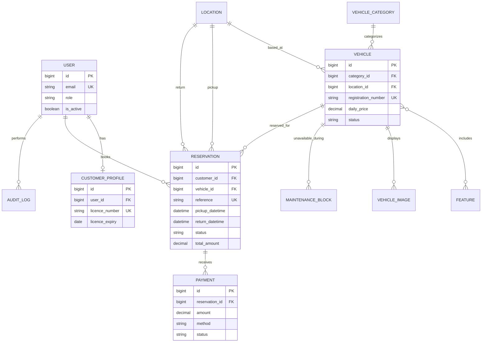

# Car Rental Management System

A responsive rental platform for customers, rental staff, and administrators.
Customers can find and reserve vehicles, while staff manage pickups, returns,
and the fleet. This project uses Django and MySQL and is configured to run
locally on port **8001**.

> **Deployment note:** Payment is simulated; do not enter or store real payment
> card details. The demo seeder generates one-time passwords and prints them
> once. Change `SECRET_KEY` and all credentials before deployment.

## Features

### Customer

- Email-based registration/login, password reset, profile and driver-license
  details.
- Browse and filter vehicles; check availability for a date/time range.
- Create, review, modify, cancel, and pay for reservations (mock card or pay at
  pickup); see rental history and printable receipts.
- Booking pricing is snapshotted. A transaction and vehicle row lock recheck
  availability when a reservation is created.

### Staff and administrator

- Dashboard KPIs, bookings and revenue charts, customer and reservation
  workflows.
- Track pickup/return odometer and fuel, damage notes, and configured late fees.
- Admin-managed vehicles, images, maintenance periods, staff, pricing policies,
  reports, CSV exports, and audit history.

### Platform

- Role-based access for customers, staff, and admins.
- Availability checks include reservation overlap, maintenance, vehicle status,
  and a configurable buffer.
- Configurable tax, weekly discounts, security deposits, late fees, and
  cancellation policies.
- Validated vehicle image uploads and generated WebP catalog thumbnails.
- Responsive, accessible pages, notifications, and custom 403/404/500 pages.

## Technology

- Python 3.11+ (container uses Python 3.13)
- Django 5.x, MySQL 8.4 / MySQL 8, `mysqlclient`
- HTML5, CSS3, Bootstrap 5, vanilla JavaScript
- Chart.js, Flatpickr, Pillow, WhiteNoise
- Gunicorn, Nginx, Docker Compose

## Project layout

```text
carrental/
├── apps/
│   ├── accounts/       # Custom user, profiles, authentication
│   ├── bookings/       # Reservations, payments, availability and pricing
│   ├── core/           # Shared policies, audit, access controls
│   ├── dashboard/      # Staff/admin workflows and reports
│   └── vehicles/       # Catalog, images, locations and maintenance
├── config/settings/    # base.py, dev.py, prod.py, test.py
├── deploy/             # Nginx production and local sample configs
├── static/             # CSS and JavaScript
├── templates/          # Shared, account, booking, catalog and dashboard UI
├── Dockerfile
├── docker-compose.yml
├── gunicorn.conf.py
└── manage.py
```

## Data model

See [System Architecture and User Flows](docs/system-architecture.md) for
deployment components and customer/staff workflow diagrams.



## Local setup (Windows PowerShell)

### Requirements

- Python 3.11 or newer
- MySQL 8, with a database and user that can create tables
- A C compiler and MySQL development headers only if a `mysqlclient` wheel is
  unavailable for your Python version

From the project directory:

```powershell
py -3.11 -m venv .venv
.\.venv\Scripts\Activate.ps1
python -m pip install --upgrade pip
pip install -r requirements-dev.txt
Copy-Item .env.example .env
```

Edit `.env` locally. Replace the `SECRET_KEY` placeholder with a random value
of at least 50 characters (for example, generate one with
`python -c "import secrets; print(secrets.token_urlsafe(64))"`), and set your
MySQL credentials. Never commit `.env`. Create the database as a MySQL
administrator:

```sql
CREATE DATABASE carrental
  CHARACTER SET utf8mb4
  COLLATE utf8mb4_unicode_ci;
CREATE USER 'carrental_user'@'localhost' IDENTIFIED BY 'use-a-unique-password';
GRANT ALL PRIVILEGES ON carrental.* TO 'carrental_user'@'localhost';
FLUSH PRIVILEGES;
```

Set `DB_NAME`, `DB_USER`, `DB_PASSWORD`, `DB_HOST=127.0.0.1`, and
`DB_PORT=3306` in `.env`, matching the MySQL account. Initialize and run:

```powershell
python manage.py migrate
python manage.py createsuperuser
python manage.py runserver 8001
```

Visit <http://127.0.0.1:8001/>. The admin is at `/admin/`. Django's test
settings use an in-memory SQLite database, so automated tests do not require a
local MySQL server.

## Docker Compose setup

Install Docker Desktop, then copy `.env.example` to `.env`. Set strong values
for `SECRET_KEY`, `DB_PASSWORD`, and `MYSQL_ROOT_PASSWORD`; Compose uses the DB
credentials to initialize MySQL. The Compose file overrides the app's `DB_HOST`
to `db` and uses HTTP-only cookie settings for the local Docker-only sample.
Do not use these local HTTP overrides in a public deployment.

```powershell
docker compose up --build -d
docker compose exec web python manage.py migrate
docker compose exec web python manage.py createsuperuser
```

Open <http://localhost:8001/>. Set `WEB_PORT` to choose another host port.
Follow logs with
`docker compose logs -f web nginx db`. Stop containers with
`docker compose down`; database and uploaded media persist in named volumes.
`docker compose down -v` removes those volumes and permanently deletes their
data.

## Environment variables

| Variable | Required | Purpose |
|---|---:|---|
| `SECRET_KEY` | Yes | Django signing key; use a unique secret in every environment. |
| `DEBUG` | Local only | Enables development behavior; production settings always set it to `False`. |
| `ALLOWED_HOSTS` | Yes | Comma-separated accepted hostnames. |
| `DB_NAME` | Yes | MySQL database name. |
| `DB_USER` | Yes | MySQL application user. |
| `DB_PASSWORD` | Yes | MySQL application password. |
| `DB_HOST` | Yes | MySQL hostname (`db` in Compose). |
| `DB_PORT` | No | MySQL port; defaults to `3306`. |
| `MYSQL_ROOT_PASSWORD` | Compose | Root password for the local MySQL container; not used by Django. |
| `EMAIL_BACKEND` | No | Defaults to SMTP; development always uses console mail. |
| `EMAIL_HOST` | No | SMTP server hostname. |
| `EMAIL_PORT` | No | SMTP port; defaults to `587`. |
| `EMAIL_HOST_USER` | No | SMTP username. |
| `EMAIL_HOST_PASSWORD` | No | SMTP credential. |
| `EMAIL_USE_TLS` | No | Whether SMTP uses STARTTLS. |
| `DEFAULT_FROM_EMAIL` | No | Sender shown on application email. |
| `CSRF_TRUSTED_ORIGINS` | Production | Comma-separated full origins, including `https://`. |
| `SECURE_SSL_REDIRECT` | Production | Redirect HTTP to HTTPS; defaults to `True`. |
| `SECURE_HSTS_SECONDS` | Production | HSTS duration in seconds; defaults to one year. |
| `SECURE_HSTS_INCLUDE_SUBDOMAINS` | Production | Include subdomains in HSTS; defaults to `True`. |
| `SECURE_HSTS_PRELOAD` | Production | Enable HSTS preload directive; defaults to `True`. |
| `SESSION_COOKIE_SECURE` | Production | Send session cookie only over HTTPS; defaults to `True`. |
| `CSRF_COOKIE_SECURE` | Production | Send CSRF cookie only over HTTPS; defaults to `True`. |
| `TRUST_X_FORWARDED_PROTO` | Production | Trust `X-Forwarded-Proto` from a trusted TLS proxy; defaults to `True`. |
| `SECURE_REFERRER_POLICY` | No | Defaults to `same-origin`. |
| `PORT` | No | Gunicorn bind port; defaults to `8000`. |
| `WEB_CONCURRENCY` | No | Gunicorn worker count; defaults to `3`. |
| `GUNICORN_TIMEOUT` | No | Gunicorn worker timeout in seconds; defaults to `60`. |
| `WEB_PORT` | No | Docker Compose host HTTP port; defaults to `8001`. |

Use secure secrets management in production rather than copying development
credentials. The production Nginx sample assumes certificates mounted at
`/etc/nginx/certs/` and Nginx is the trusted TLS-terminating proxy.

## Demo data and accounts

Seed the catalog and demo identities after applying migrations:

```powershell
python manage.py seed_demo_data
```

This creates three locations, seven vehicle categories, 15 features, 20
vehicles, and:

| Email | Role |
|---|---|
| `admin@carrental.test` | Admin / superuser |
| `staff@carrental.test` | Staff |
| `customer@carrental.test` | Customer |

For newly created demo users, the command generates strong random passwords and
prints them once. Save the output securely; rerunning the command does not reset
existing passwords. Create additional administrators with
`python manage.py createsuperuser`.

## Tests and quality checks

```powershell
python manage.py test --settings=config.settings.test
python -m coverage run --source=apps -m django test --settings=config.settings.test
python -m coverage report -m --fail-under=80 --include="apps/*/services/*.py,apps/*/views.py"
python -m black --check apps config
python -m flake8 apps config
python manage.py check
python manage.py check --deploy --settings=config.settings.prod
```

Django Debug Toolbar is enabled in development when installed from
`requirements-dev.txt`; browse pages and inspect SQL at `/__debug__/`. The
vehicle catalog tests also enforce a maximum query count for listing and related
images.

## Production deployment

1. Provision MySQL 8, a TLS certificate, persistent media storage, and a host
   with Docker or Python 3.11+.
2. Set `DJANGO_SETTINGS_MODULE=config.settings.prod` and all production
   environment variables. Set `ALLOWED_HOSTS` and `CSRF_TRUSTED_ORIGINS` to
   your actual domain(s). Keep `DEBUG=False`.
3. Configure the trusted HTTPS proxy to overwrite `X-Forwarded-Proto`. Django
   uses this header to recognize HTTPS; do not trust it from arbitrary clients.
4. Build and deploy the application with Gunicorn. With Docker Compose, adapt
   `docker-compose.yml` for your host, mount certificates, and use
   `deploy/nginx.conf` rather than `deploy/nginx-local.conf`. Publish ports 80
   and 443 and update the Nginx `server_name`.
5. Apply schema changes as a controlled release step:

   ```sh
   python manage.py migrate
   ```

   Or in a running Compose deployment:

   ```sh
   docker compose exec web python manage.py migrate
   ```

6. Collect static files during image build or release:

   ```sh
   python manage.py collectstatic --noinput
   ```

   WhiteNoise serves the generated static assets. Preserve the media directory
   separately and back it up.
7. Run `python manage.py check --deploy --settings=config.settings.prod`, verify
   the site through HTTPS, test mail delivery and backups, and create the first
   admin using `createsuperuser`.
8. Schedule `python manage.py send_reminders` hourly. Use a process supervisor
   to restart Gunicorn and monitor application, Nginx, and database logs.

### Screenshots

Add reviewed screenshots to `docs/screenshots/` and replace these placeholders:

| Page | Desktop | Mobile |
|---|---|---|
| Home and search | `docs/screenshots/home-desktop.png` | `docs/screenshots/home-mobile.png` |
| Vehicle catalog | `docs/screenshots/catalog-desktop.png` | `docs/screenshots/catalog-mobile.png` |
| Booking journey | `docs/screenshots/booking-desktop.png` | `docs/screenshots/booking-mobile.png` |
| Operations dashboard | `docs/screenshots/dashboard-desktop.png` | `docs/screenshots/dashboard-mobile.png` |

## Manual QA checklist

Use separate customer, staff, and admin accounts. Check each customer and
operations task at desktop width and again at a narrow mobile viewport.

### Customer journey — desktop and mobile

- [ ] Home page loads, date fields are labeled, and search submits valid dates.
- [ ] Catalog filters, sorting, pagination, and mobile filter drawer work.
- [ ] Vehicle detail images have useful alternate text; booking card is usable.
- [ ] Guest booking redirects to login and returns to the requested flow.
- [ ] Registration enforces age, unique email, strong password, and license rules.
- [ ] Customer can review an accurate quote, choose payment option, and receive
      a confirmation/reference.
- [ ] Overlapping or maintenance-blocked dates cannot be booked; adjacent dates
      obey the configured buffer.
- [ ] Booking history tabs, detail page, receipt/print, modify, cancel, and
      book-again links work for the owner.
- [ ] A different customer cannot view or change another customer's booking.
- [ ] Password reset email can be requested and its link completes the reset.
- [ ] Forms are keyboard-operable; error messages, loading states, and toasts are
      announced and visible.

### Staff and admin journey — desktop and mobile

- [ ] Staff can access permitted dashboard views but cannot access admin-only
      features.
- [ ] Admin can create/edit vehicles and images, change status, and schedule
      maintenance; retired vehicles disappear from the public catalog.
- [ ] Staff/admin can find reservations and make only valid lifecycle changes.
- [ ] Pickup and return capture odometer/fuel; return records damage and late
      fees correctly.
- [ ] Admin customer/staff management, reactivation/deactivation, audit log,
      settings, reports, and CSV downloads work.
- [ ] Tables remain readable or horizontally scrollable on mobile; dashboard
      navigation remains reachable.
- [ ] `/admin/` works for an authorized superuser; unauthorized users receive a
      safe access-denied response.

### Deployment smoke checks

- [ ] `check --deploy` has no unresolved warnings for the deployed domain/proxy.
- [ ] HTTP redirects to HTTPS; secure cookies are only sent over HTTPS.
- [ ] Static files, uploaded media, and image thumbnails load after deployment.
- [ ] SMTP delivery, database connectivity, restart behavior, and backups are
      verified without displaying secrets in logs.
