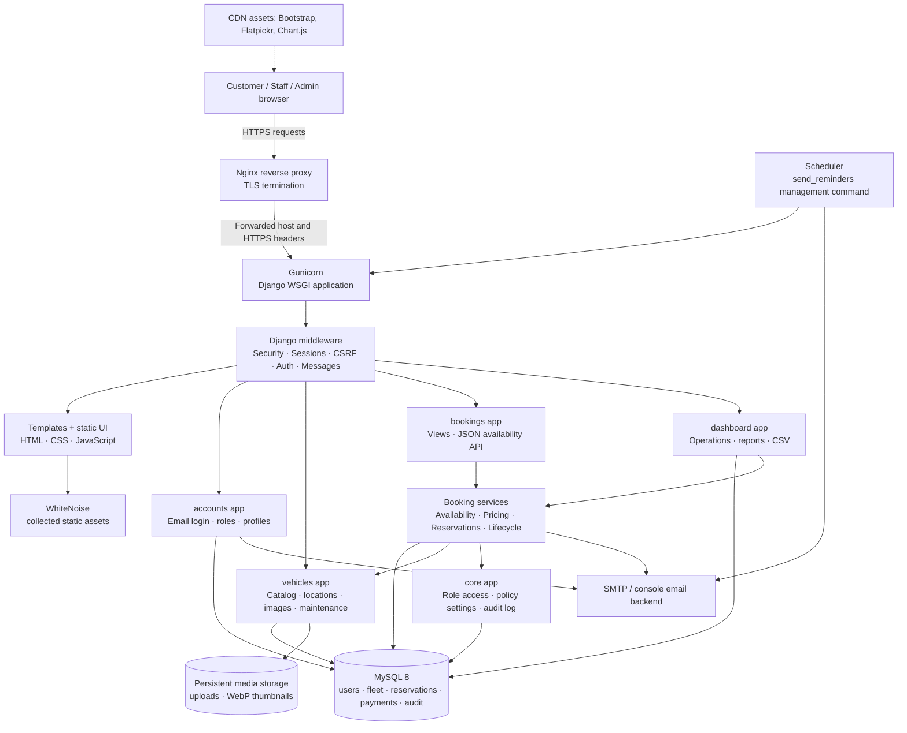
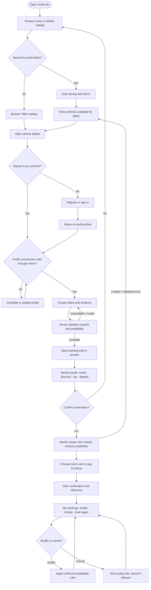
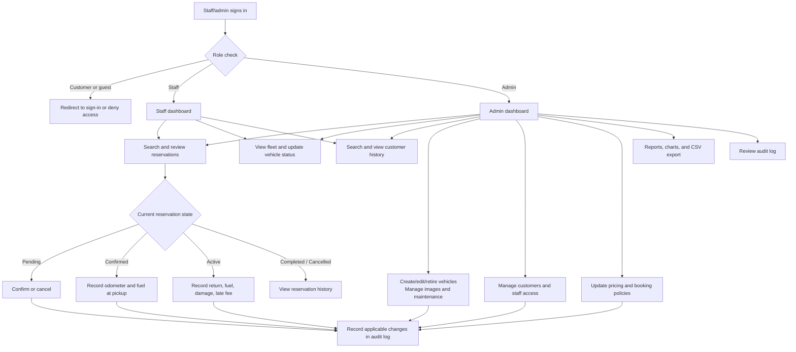

# System Architecture and User Flows

These diagrams describe the implemented Django application and its typical
deployment. Mermaid diagrams render in GitHub and compatible Markdown viewers.

## System architecture

### Request and booking boundaries

- The browser uses Django-rendered pages, ordinary form posts, and the
  read-only availability endpoints.
- Django middleware applies security headers, session/authentication handling,
  CSRF checks, and message handling before application views.
- Views perform request validation and authorization, while reservation,
  availability, pricing, cancellation, and lifecycle rules live in service
  modules.
- Reservation creation is transactional: it locks the vehicle row and checks
  availability again before saving the reservation and its price snapshot.
- MySQL stores application records. Uploaded images and their generated
  thumbnails live in persistent media storage; WhiteNoise serves collected
  static files.
- The production Nginx sample terminates HTTPS and forwards
  `X-Forwarded-Proto` to Django. Deployments must use trusted proxy
  configuration and persistent storage for media.

## Customer user flow

## Staff and administrator user flow

## Main application URLs

| Area | URL prefix | Typical use |
|---|---|---|
| Public home | `/` | Search rental dates and see featured vehicles |
| Accounts | `/accounts/` | Register, login, profile, password reset |
| Vehicle catalog | `/vehicles/` | Browse, filter, and inspect vehicles |
| Booking API | `/api/` | Availability quote and booked-date data |
| Customer bookings | `/bookings/` | Create, review, manage, and print reservations |
| Staff/admin dashboard | `/dashboard/` | Fleet, lifecycle, customers, and reports |
| Django admin | `/admin/` | Django administration for authorized staff |
